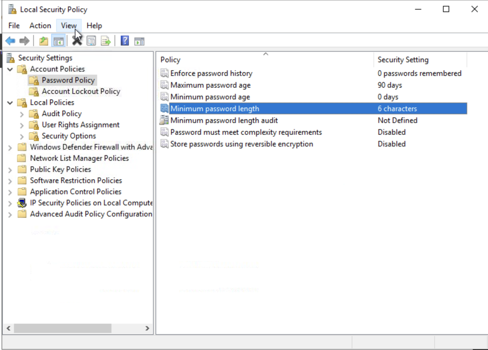
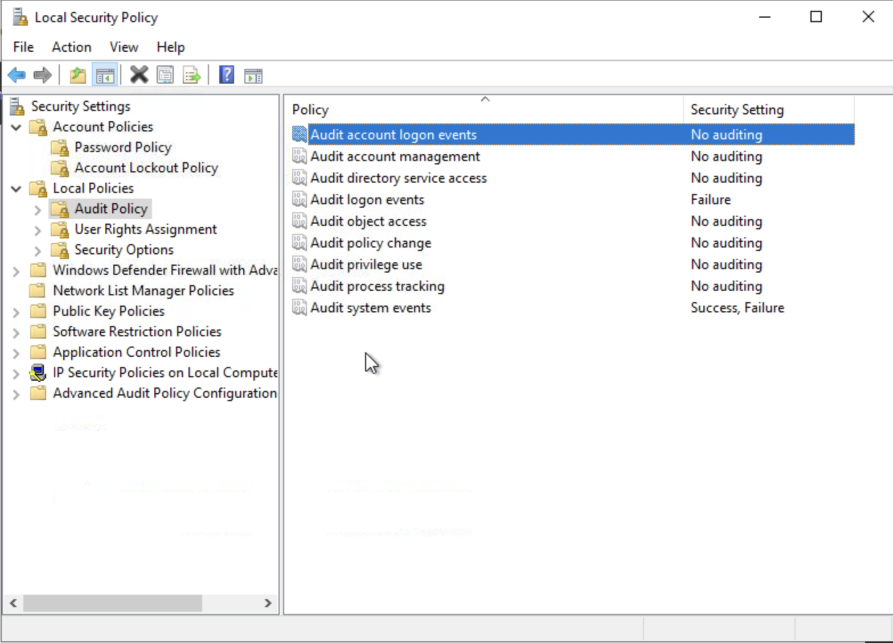

# Incident Response Preparation — TryHackMe Lab

## Overview

**Completed November 6, 2026 — [100% room completion screenshot](./screenshots/room-completion.png).**

This project documents my work through TryHackMe's [Preparation room](https://tryhackme.com/room/irpreparation), which focuses on preparing an organization to respond to security incidents. The practical scenario involves reviewing the incident response readiness of the fictional organization Nexus Financial.

## Learning Objectives

- Understand the role of preparation in the incident response lifecycle.
- Review how people, processes, and technology support incident response.
- Explore the incident response frameworks covered in the room.
- Understand how logging, visibility, and detection support investigations.
- Identify preparation gaps in the provided scenario.

## Lab Notes

I reviewed the supplied preparation documents and inspected the lab workstation's Local Security Policy. The document review covered asset identification and existing penetration test findings; the workstation review covered password and audit settings.

## Practical Assessment

| Observation | Evidence | Significance |
| --- | --- | --- |
| The listed mail server is `MAIL-01`, with IP address `10.10.10.2`. | [Asset Inventory](./documents/Asset_Inventory.pdf), asset NXF-002 | Provides a documented asset reference for investigation; I did not independently verify network reachability. |
| MFA is not enforced for standard user accounts in the Nexus Financial Entra ID environment. | [Pentest Report](./documents/Pentest_Report_2025.pdf), NXF-PT-001 | The report identifies password-only authentication as an account access risk. |
| The penetration test identified **2 High severity findings**. | [Pentest Report](./documents/Pentest_Report_2025.pdf), findings summary | These are missing MFA enforcement and missing SPF, DKIM, and DMARC configuration. Both are recorded as open as of March 2026. |
| The local workstation's minimum password length is **6 characters**. | [Local password policy screenshot](./screenshots/local-password-policy.png) | Records the displayed local policy; this does not establish the Entra ID password policy. |
| **Audit account logon events** is set to **No auditing**. | [Local audit policy screenshot](./screenshots/local-audit-policy.png) | Identifies a gap in the displayed basic local audit settings. Advanced audit policy and resulting event logs were not verified. |

The audit screenshot also shows **Audit logon events: Failure** and **Audit system events: Success, Failure**. Account logon auditing and logon auditing are separate settings, so this evidence does not mean all logon auditing is disabled.

## Lab Documents

These PDFs were reconstructed from screenshots of the fictional Nexus Financial documents supplied in the lab. Formatting was rebuilt for readability; these are not the original downloadable files.

- [Asset Inventory](./documents/Asset_Inventory.pdf)
- [Incident Response Communication Plan](./documents/Communication_Plan.pdf)
- [Historic Incidents Log](./documents/Historic_Incidents.pdf)
- [Incident Response Policy](./documents/IR_Policy.pdf)
- [2025 Penetration Testing Report](./documents/Pentest_Report_2025.pdf)

The scenario uses Microsoft 365 for email, file storage, and collaboration, with employee identities managed through Entra ID.

## Screenshots

- [Room completion](./screenshots/room-completion.png) — shows 100% completion and all seven tasks checked.
- [Provided lab documents](./screenshots/provided-lab-documents.png) — shows the five PDFs supplied in the Nexus folder.
- [Local Security Policy overview](./screenshots/local-security-policy-overview.png) — shows the policy categories reviewed on the workstation.
- [Screenshot evidence index](./screenshots/README.md)

### Local Password Policy

The workstation displays a minimum password length of 6 characters, password history of 0 remembered passwords, a maximum password age of 90 days, and a minimum password age of 0 days. Complexity requirements and reversible password encryption are disabled; minimum password length audit is not defined.

### Local Audit Policy

The selected **Audit account logon events** setting shows **No auditing**. The screenshot captures the displayed configuration, rather than a test of effective event generation.

## Key Takeaways

This lab connected preparation documents with visible workstation settings. The inventory supplied an asset reference, the penetration test documented unresolved identity and email control gaps, and Local Security Policy exposed password and audit settings for review. Each source has a different scope: a local workstation screenshot cannot establish cloud identity settings, and a report finding is not an independently repeated test.

## References

- [TryHackMe — Preparation](https://tryhackme.com/room/irpreparation)
- [Back to portfolio](../../README.md)
